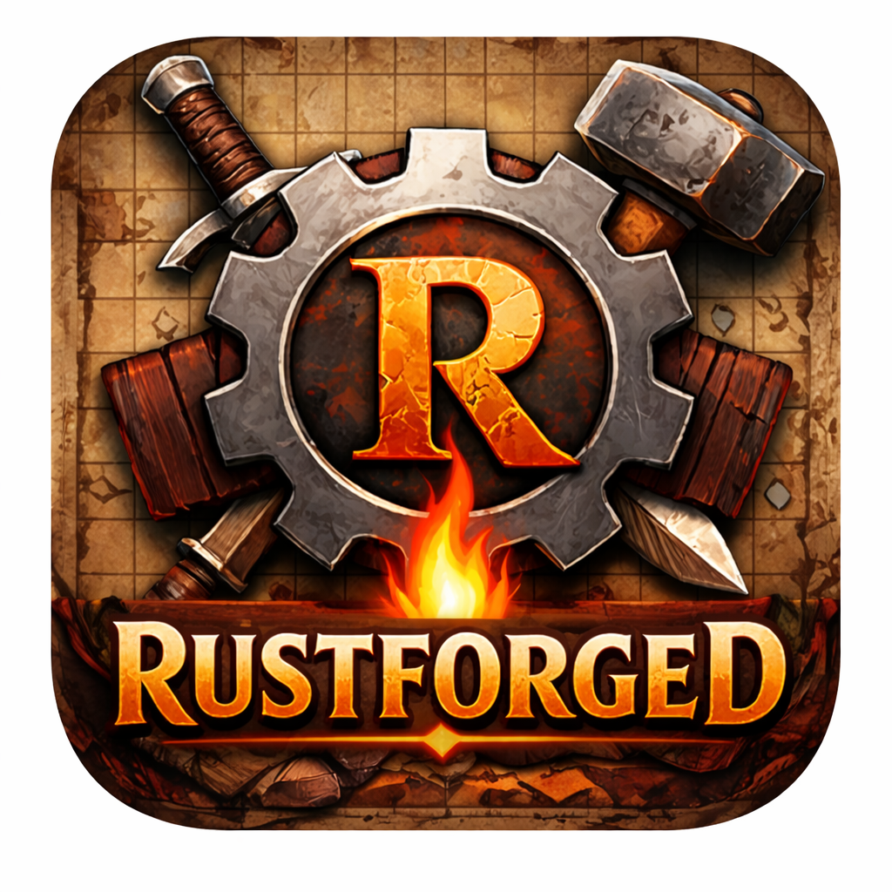

# Rustforged

<p align="center">
  
</p>

A D&D 5E Virtual Tabletop (VTT) map editor built with Bevy 0.20 and bevy_egui 0.43.

## Features

- **Layer-based map editing** - Background, Terrain, Doodad, Token, GM, Annotation, and Fog of War layers, each lockable and hideable
- **Asset library management** - Create, open, and organize asset libraries; drag images in from the desktop
- **Battlemaps** - Drop a battlemap image to place it fitted to the grid, or fit any image to a number of cells
- **Notes and drawing** - Freehand drawing, straight lines, and text notes, seen only by the GM
- **Measuring** - A ruler, spell templates (circle, cone, square, line), and pings, which players see too
- **Undo/redo** - Every map edit: placing, moving, properties, deleting, notes, and fog
- **Fog of War** - Reveal or cover with a brush or a rectangle of cells
- **Grid system** - 70px grid with snap-to-grid placement (hold Ctrl for free placement)
- **Live session mode** - The player view on a second monitor: frame it with the viewport, freeze it while you edit, black it out, or show it at table scale (1 cell = 1 inch)
- **Scenes** - Keep several maps open and switch between them mid-session
- **Map files** - Saved as JSON; unsaved changes are autosaved and offered back after a crash, and a save warns before overwriting a copy changed elsewhere (by a sync service, say)

## Downloads

Pre-built installers are available for Windows and macOS:

| Platform | Download |
|----------|----------|
| Windows (x64) | [MSI Installer](https://github.com/fitz11/rustforged/releases/latest) |
| Windows (ARM64) | [MSI Installer](https://github.com/fitz11/rustforged/releases/latest) |
| macOS (Apple Silicon) | [DMG](https://github.com/fitz11/rustforged/releases/latest) |
| Linux (x86_64) | [Tarball](https://github.com/fitz11/rustforged/releases/latest) (`.tar.gz`) — or build from source (recommended, see below) |

## Quick Start

### Build from Source

```bash
# Install Rust via rustup.rs, then:
git clone https://github.com/fitz11/rustforged.git
cd rustforged
cargo run
```

**Linux dependencies:** `pkg-config libudev-dev libwayland-dev libxkbcommon-dev` (Debian/Ubuntu)

### Linux Tarball

The Linux release is a plain `.tar.gz` (built for **x86_64**, no installer). Building from source is recommended for the simplest experience — the tarball is just an unpacked binary with no desktop integration or dependency management, and it's forward-compatible only from the glibc it was built against (Ubuntu LTS).

```bash
# Extract, then run the binary directly:
tar -xzf rustforged-*-linux-x86_64.tar.gz
cd rustforged-linux
chmod +x rustforged      # ensure the executable bit survived extraction
./rustforged
```

The archive contains the `rustforged` binary plus the default `assets/` library — run it from inside `rustforged-linux/` so it finds them.

If the binary fails to start with a missing-library error (`error while loading shared libraries: ...`), install the runtime libraries for your distro:

- **Ubuntu / Debian:** `sudo apt install libudev1 libxkbcommon0 libwayland-client0`
- **Arch:** `sudo pacman -S systemd-libs libxkbcommon wayland`

(Most desktop installs already have these.) If you hit a glibc version mismatch on a rolling distro like Arch, build from source instead.

## Controls

Ctrl is Cmd on macOS. Press **H** in the app for this list.

### Tools

| Keys | Action |
|------|--------|
| V / S | Select: click to select, drag to move |
| P | Place: click to place the selected asset, then back to Select |
| B | Brush: drag to paint the selected asset into each cell |
| D | Draw: freehand annotation paths |
| L | Line: straight line annotations |
| T | Text: click to type a note, click a note to edit it |
| F | Fog: drag to reveal fog of war, right-drag to cover it |
| M | Measure: drag a ruler or spell template that players see too |
| C / Shift+C | Cycle the target layer (Place and Brush) |
| H | Show or hide this help |

### Placing

| Keys | Action |
|------|--------|
| Shift+Click | Place and keep the Place tool for another |
| Ctrl+Click | Place without snapping to the grid |
| Shift+Drag (Brush) | Fit each painted asset to one cell |

### Selection

| Keys | Action |
|------|--------|
| Click | Select the topmost item |
| Ctrl+Click | Add to or remove from the selection |
| Drag on empty space | Box select |
| Drag | Move the selection (Shift: whole cells) |
| Drag a handle | Resize (Shift keeps the shape) or rotate (Shift: 15° steps) |
| Escape | Clear the selection |
| Delete / Backspace | Delete the selection |
| G | Fit to one grid cell |
| Shift+G | Center in its grid cell |
| A | Restore the aspect ratio |
| R / Shift+R | Rotate 90° clockwise / counter-clockwise |

### Editing

| Keys | Action |
|------|--------|
| Ctrl+C / Ctrl+X / Ctrl+V | Copy / cut / paste |
| Ctrl+Z | Undo |
| Ctrl+Y / Ctrl+Shift+Z | Redo |

### Fog

| Keys | Action |
|------|--------|
| Drag (Fog) | Reveal with the brush |
| Right-drag (Fog) | Cover with the brush |
| Shift+Drag (Fog) | Reveal (or with the right button, cover) a rectangle of cells |

### Measuring

| Keys | Action |
|------|--------|
| Drag (Measure) | Measure from where the drag starts; it stays up until the next one |
| Ctrl+Drag (Measure) | Measure without snapping to the grid |
| Click or Escape | Clear the ruler or template |
| Alt+Click | Ping a spot, on the player screen too |

### Notes

| Keys | Action |
|------|--------|
| Enter (Text) | Keep the note |
| Escape (Text) | Cancel the edit |

### Camera

| Keys | Action |
|------|--------|
| Middle-mouse drag / Space+Drag | Pan |
| Arrow keys | Pan (faster with Shift) |
| Scroll wheel | Zoom toward the cursor |
| Trackpad scroll / pinch | Pan / zoom (Ctrl+scroll zooms too) |
| Home | Frame the map, or the player view during a session |

### Files

| Keys | Action |
|------|--------|
| Ctrl+N | New map |
| Ctrl+O | Open a map file |
| Ctrl+S | Save |
| Ctrl+Shift+S | Save as |
| F2 | Rename the selected asset |
| F3 | Rename the map |
| F4 | Rename the library |

### Live session

| Keys | Action |
|------|--------|
| Ctrl+B | Black out the player screen, or show the map again |
| Escape (player window) | End the session |

## Asset Library

The default library is the `library/` folder next to the config file (`~/.config/rustforged/library/` on Linux; `./library/` when run with `cargo run`), created with `terrain/`, `doodads/` and `tokens/` folders.

You can open or create other asset libraries via the left panel, and drag images onto the map from the desktop to copy them in. Maps are saved to `<library>/maps/`. A library can live in a synced folder (Dropbox, OneDrive, iCloud): caches are kept outside it, and saving warns before overwriting a map that was changed on another computer.

**Supported formats:** PNG, JPG, JPEG, WebP, GIF, BMP, TIFF

## Live Session Mode

1. Click "Start Session" in the toolbar
2. Select which monitor to display the player view
3. Drag the viewport indicator to frame the player view
4. Resize using corner handles (maintains aspect ratio)

The player window shows a fullscreen view without the GM layer, notes, or viewport indicator. Rulers, spell templates and pings from the Measure tool show there too.

**Blackout** (Ctrl+B, or the switch in the Live Session panel) shows players a black screen, for example while you switch scenes. To switch scenes, open another map with the **+** next to it in the Maps list, then pick it from the open maps; each map remembers where the player view was.

**Table scale:** with a screen laid flat on the table, enter its width in inches in the Live Session panel and click **1 cell = 1 inch**, so miniatures fit the grid. The width is remembered for each monitor.

### Freezing the player view

Turn on **Freeze player view** in the Live Session panel to edit the map without players seeing it. Players keep seeing the map, fog, and grid as they were at that moment; turn it off to show them everything at once. While frozen, the toolbar shows **LIVE · FROZEN** and the viewport indicator turns blue.

By default the player view also holds still while frozen, so you can frame the next reveal with the viewport; a faint outline marks what players currently see. To keep moving the player view with the viewport instead, enable **Move the player view while it's frozen** in Settings.

## Dependencies

Built on [Bevy](https://bevyengine.org) 0.20 (rendering, ECS, windowing) and [bevy_egui](https://github.com/vladbat00/bevy_egui) 0.43 (the panels and dialogs). [`Cargo.toml`](Cargo.toml) lists the rest, with what each is for.

## License

MIT OR Apache-2.0
